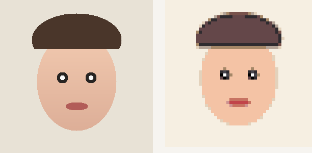
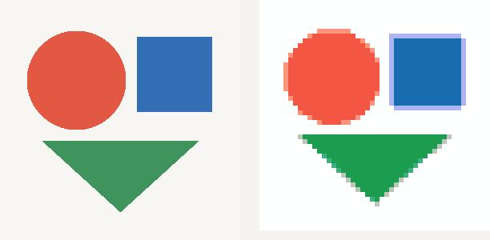
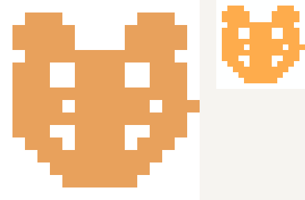

# 拼豆图纸

把一张照片变成**能照着摆、能照着买**的拼豆图纸。

自动配色、标色号、算用量、分底板。**全程本地运行，图片不上传、不联网、不收费。**



<sub>左：原图　右：48×48 格的成品图纸，14 色 2304 颗</sub>

---

## 它解决什么问题

拼豆玩家把照片做成图纸，通常得走这三条路：

| 做法 | 问题 |
| --- | --- |
| 用付费工具的免费额度 | 一天只能做几张，导出还带水印 |
| 用在线工具 | 照片要上传到别人服务器，不知道拿去干什么 |
| 手动数格子 | 一张 58×58 的图有 3364 格，数完眼睛废了 |

这个项目想证明的是：**这件事可以完全在本地做完，而且做得好。**

没有账号、没有额度、没有水印，图片不离开设备。

## 能做什么

- **照片转图纸**：自动从 221 色里选色，每格标色号，算出每种颜色需要多少颗
- **像素图 1:1 导入**：自动识别格子边长，一个像素都不改
- **去杂质**：把纹理噪点形成的零碎小色块合并掉
- **背景剔除**：白墙、纯色布这类背景直接变成空格，用豆量能减一半
- **比例裁切**：原图 / 1:1 / 4:3 / 3:4，一键切
- **单板视图**：一块底板（29×29）单独放大，每格色号看得清
- **实时调参**：格数、色数拖动即时重算，不用返回重来
- **精确用量**：每种色的颗数、需要几块底板、成品多少厘米

## 效果

| 几何图形 | 像素图 1:1 导入 |
| --- | --- |
|  |  |

左原图、右成品。几何图用 8 色，像素图导入后 16×16 格完全还原。

## 怎么跑

### 微信小程序（主形态）

需要 [HBuilderX](https://www.dcloud.io/hbuilderx.html)：

```
HBuilderX → 打开目录 → apps/uni → 运行到小程序模拟器 → 微信开发者工具
```

首次运行填自己的小程序 AppID（`manifest.json` → 微信小程序配置）。

也可以纯命令行：

```bash
pnpm install
pnpm build:mp                            # 打包算法与色卡
cd apps/uni && npx uni build -p mp-weixin
# 产物在 apps/uni/dist/build/mp-weixin，用微信开发者工具导入
```

### 浏览器（验证算法用）

```bash
pnpm install
pnpm dev        # → http://127.0.0.1:5173
```

调参用的验证台：左边显示算法输入（降采样后的图），右边显示成品图纸，改参数实时重算。调算法时看这个比看小程序快。

### H5

```bash
cd apps/uni && npx uni -p h5
```

同一套代码，`manifest.json` 里 h5 段已配好。

## 技术

```
packages/core/          纯 TypeScript，零平台依赖，浏览器 / 小程序 / Node 通用
├── color/
│   ├── space.ts        sRGB → Linear → XYZ(D65) → Lab
│   └── deltaE.ts       CIEDE2000（通过 Sharma 34 组标准数据校验）
├── image/
│   ├── resample.ts     面积平均降采样、保边锐化、比例裁切
│   ├── detect.ts       判断照片还是像素图（跑一遍 GCD 找格子边长）
│   └── background.ts   四角采样 + 边缘泛洪，剔除纯色背景
├── quantize/
│   ├── kmeans.ts       Lab 空间加权 K-means（肤色权重更高）
│   ├── palette.ts      聚类中心 → 最近色号，含相近色合并
│   └── assign.ts       逐格分配：Lab 欧氏取前 4 候选，再 ΔE00 精选
└── pattern/
    ├── builder.ts      主流程 + 自动调参
    ├── denoise.ts      连通域清理（按面积合并小色块）
    └── stats.ts        用量、底板、成品尺寸
```

三个值得一提的地方：

**1. 色彩用 CIEDE2000，不是 RGB 距离。** RGB 距离算出来的「最近色」经常肉眼一看就不对。CIEDE2000 是现行的人眼感知色差标准，实现在 `color/deltaE.ts`，用 Sharma, Wu & Dalal (2005) 论文里的 34 组参考数据自检——不通过就拒绝构建。

**2. 分配阶段是两段式。** 直接给几万像素逐个算 ΔE00 太慢，先用 Lab 欧氏距离取最近 4 个候选，再对这 4 个算 ΔE00 精选。精度几乎无损，速度快一个数量级。

**3. 去噪分两层。** 孤立单点用邻域判断清掉；成片的小色块用连通域标记、按面积合并，但会检查与邻居的色差——色差大的不动，否则眼睛高光、描边这些细节会被吃掉。

实测：300×451 格 / 65 色，全流程约 **370ms**（Node.js）。

## 色卡数据

内置 MARD 221 色 + 10 组零售套装（24/48/72/96/120/144/168/192/216/221 盒装）。

数据来自 [Craft Color Codes](https://github.com/makebead/craft-color-codes)，**CC BY 4.0**，上游是 peiseka.com 等公开色卡资料。

需要说清楚的三件事：

1. **这是社区采样，不是分光测色仪实测。** 屏幕显示和实物豆一定有偏差，不同批次也有色差。买豆前建议看商家实物色卡。
2. **真实色卡的覆盖度不如想象。** 随机取 2000 个 sRGB 颜色测最近色号：P50 = 5.57，P90 = 9.35（ΔE00）。意味着约 10% 的颜色，MARD 里根本没有接近的色号。这不是数据错误，是 221 色的客观边界。
3. **只有 MARD 221。** Perler、Hama、Artkal 的数据也有现成的，但没接进来——不同品牌色号体系互不相通，混用会让用户买错豆子。

## 已知限制

**背景剔除只对简单背景有效。** 白墙、纯色布、天空、渐变背景效果好；毛发边缘、树叶缝隙、多色复杂背景会失败。算法设计成「宁可不动手」：剔除比例低于 2% 或高于 85% 直接放弃，保留完整画面。

没有接 AI 抠图（remove.bg 之类），是因为那要求上传图片，和「图片不出设备」的承诺冲突。

**色号依赖用户手上有哪套豆。** 设置套装后只用套装内的颜色，套装外的需求会在用量清单标「补」。

**小程序未上架。** 目前只在开发者工具和真机调试里跑过，没走审核发布流程。

## 项目结构

```
packages/core/      算法核心（纯 TS）
apps/uni/           uni-app 小程序（Vue 3，可跨 H5 / App）
apps/web/           浏览器验证台
miniprogram/        原生小程序（保留作行为对照）
scripts/            色卡导入、算法验证、图标与测试图生成
test-images/        14 张测试图 + 说明
docs/               产品需求、技术方案、色卡方案
```

## 开发

```bash
pnpm install

pnpm dev                    # 验证台
pnpm build:mp               # 打包 core → 小程序 + uni-app
pnpm test                   # 单元测试

# 验证脚本
node scripts/verify-algo.mjs   # 算法正确性（26 项）
node scripts/verify-mp.mjs     # 原生小程序工程检查（46 项）
node scripts/verify-uni.mjs    # uni-app 工程检查（50 项）
node scripts/verify-bg.mjs     # 背景剔除效果
```

**改了 `packages/core` 之后必须跑 `pnpm build:mp`。** 小程序和 uni-app 用的都是打包产物，不重新打包就会出现「代码改了但没生效」。

## 参与

色号纠错是最有价值的贡献——指出「实物豆不是这个色」比改代码有用得多。

其他欢迎的方向：接入更多品牌色卡、改进背景剔除、补充测试图。

## License

代码 [MIT](LICENSE)。

色卡数据来自 Craft Color Codes，CC BY 4.0，不属于 MIT 授权范围，使用时保留署名。
